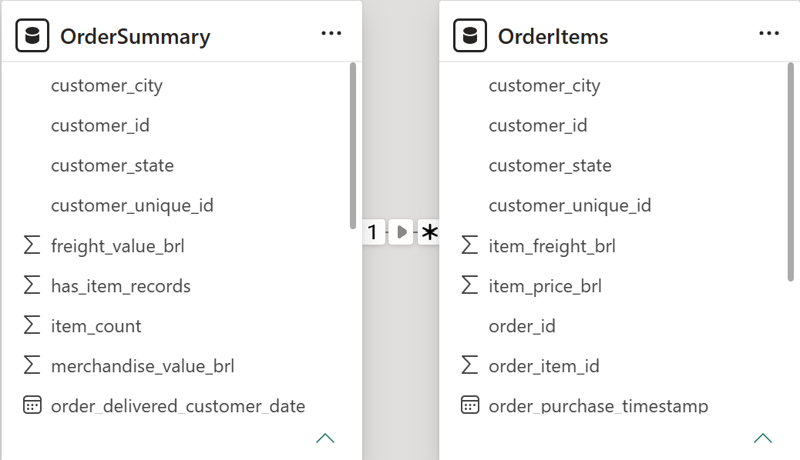
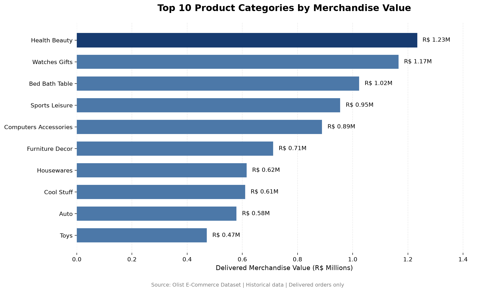
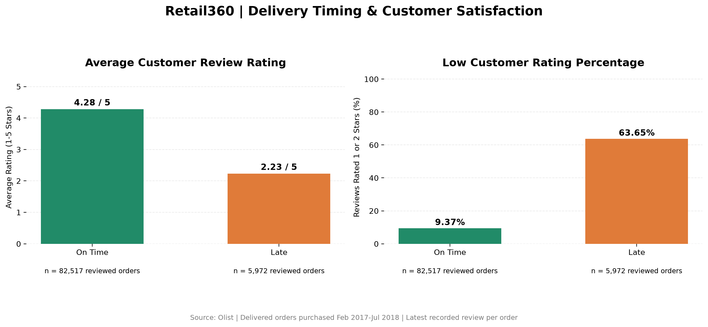

# Retail360 — E-Commerce Analytics

**Python · SQL (SQLite) · Power BI** | Historical Brazilian e-commerce transactions (Olist)

Retail360 examines merchandise performance, purchasing behaviour, geographic demand, delivery reliability and customer reviews. The analysis combines source-table validation, SQL reporting views, Python aggregations and an interactive Power BI executive report.


## Executive dashboard

The dashboard's selected reporting period is **February 2017–July 2018**, with all customer states included.

| KPI | Value | Definition |
| --- | ---: | --- |
| Delivered merchandise value | **R$12.23M** | Item prices for eligible delivered orders; excludes freight |
| Delivered orders | **89,110** | Distinct delivered orders with item records |
| Average order value | **R$137.25** | Delivered merchandise value ÷ eligible delivered orders |
| On-time delivery | **93.14%** | Share delivered on or before estimated date among orders with usable delivery dates |

The first three KPIs reconcile with the SQL order-summary view: **R$12,230,652.13** over **89,110** distinct eligible orders. The on-time result is also reported by the delivery analysis (**82,986 / 89,102 = 93.14%**); its denominator excludes delivered orders without complete dates and therefore differs from the order-count KPI.

## Findings

- **Category concentration.** The ten highest-value categories represent **62.43%** of merchandise value in the category analysis. Category mix matters when interpreting the headline total.
- **Low repeat-purchase incidence.** Of **93,358** unique customers in the customer-frequency analysis, **2,801 (3.0%)** placed repeat orders. This is a descriptive historical measure, not an estimated retention rate for a future cohort.
- **Delivery and reviews.** Orders classified as late averaged **2.23/5** in review score, compared with **4.28/5** for on-time orders in the reviewed-order sample. The relationship is observational, not proof of causality.
- **Geographic variation.** São Paulo leads state-level merchandise value. State and purchase-month slicers allow the dashboard to separate overall performance from local demand patterns.

These findings come from analyses with potentially different eligibility and reporting windows; figures are not combined into a single population unless explicitly stated.

## Data model and methodology



1. **Audit source data:** inspect record counts, missing fields, duplicate rows, primary keys and order/item relationships.
2. **Build reporting tables:** load the nine Olist source CSVs into SQLite; create indexed tables and SQL views. `vw_order_summary` aggregates items and payments before joining to order headers, maintaining one row per order. `vw_item_sales` retains item-level detail.
3. **Analyse:** calculate category contribution, monthly trends, order frequency, state-level demand, delivery punctuality and review patterns with Python and SQL.
4. **Visualise:** feed the `OrderSummary` and `OrderItems` exports into Power BI with a **1-to-many** relationship on `order_id`. The report uses KPI cards, bar and line charts, and interactive state/date slicers.

**Selected implementation:** [Database ingestion](scripts/21_build_sql_database.py) · [Reporting views](sql/06_reporting_views.sql) · [Data-quality SQL](sql/05_data_quality.sql) · [Power BI export](scripts/24_export_powerbi_data.py)

## Supporting visuals

| Product category performance | Delivery and customer reviews |
| --- | --- |
|  |  |

Additional figures are available in [`assets/`](assets/) and summary outputs in [`reports/`](reports/).

## Repository contents

```text
assets/          Power BI captures and generated Python visualisations
scripts/         Data audits, transformations, analysis and chart generation
sql/             Aggregations, joins, CTEs, window functions, quality checks, reporting views
reports/         Selected aggregate CSV outputs
requirements.txt Python dependencies
```

## Reproducing the analysis

Source data are not stored in this repository. Obtain the nine original CSV files from the [Olist dataset on Kaggle](https://www.kaggle.com/datasets/olistbr/brazilian-ecommerce), and place them in `data/raw/` with their original filenames. Install the packages in `requirements.txt` in a Python 3.12 environment.

Execute the Python scripts in numerical order from the repository root. `scripts/21_build_sql_database.py` creates the SQLite database, `scripts/23_build_reporting_views.py` creates the reporting views, and `scripts/24_export_powerbi_data.py` writes `data/powerbi/OrderSummary.csv` and `OrderItems.csv`. The SQL quality-check runner uses `sql/05_data_quality.sql`. The original Power BI `.pbix` is not distributed because it contains an imported data model; the report and model are documented through screenshots above.

**Limitations:** Historical, anonymised marketplace data; merchandise value is not accounting revenue or profit. Some source records lack matched order items or complete delivery timestamps. Category- and order-level summaries have different counting units, and some analyses use different date ranges.

## Data source and attribution

[Olist — Brazilian E-Commerce Public Dataset (Kaggle)](https://www.kaggle.com/datasets/olistbr/brazilian-ecommerce), licensed **[CC BY-NC-SA 4.0](https://creativecommons.org/licenses/by-nc-sa/4.0/)**. Olist retains the rights to its source dataset; analyses and derived artifacts are presented for non-commercial use under the applicable source terms.
