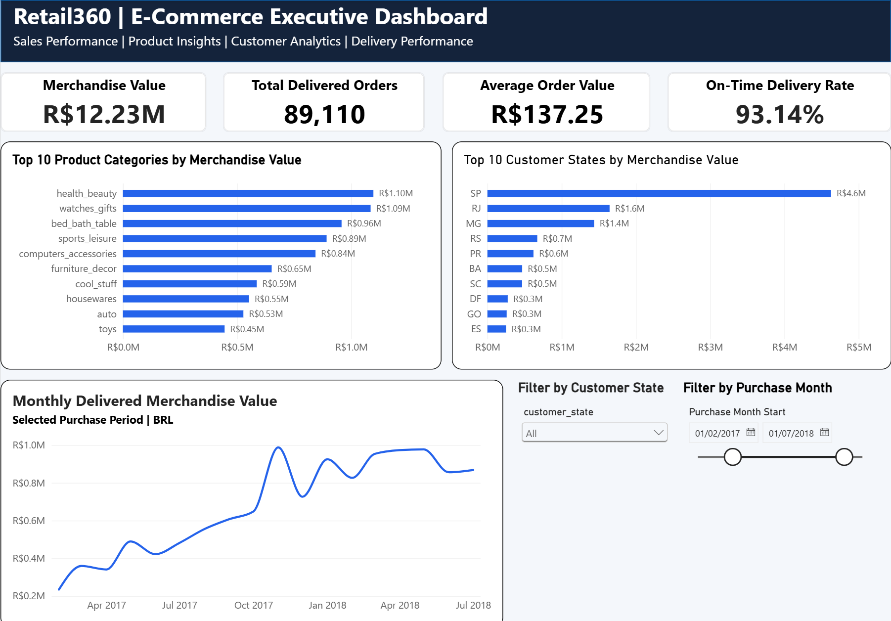
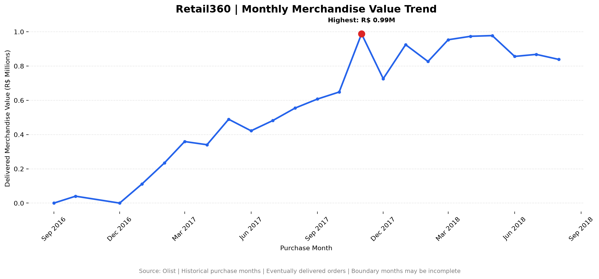
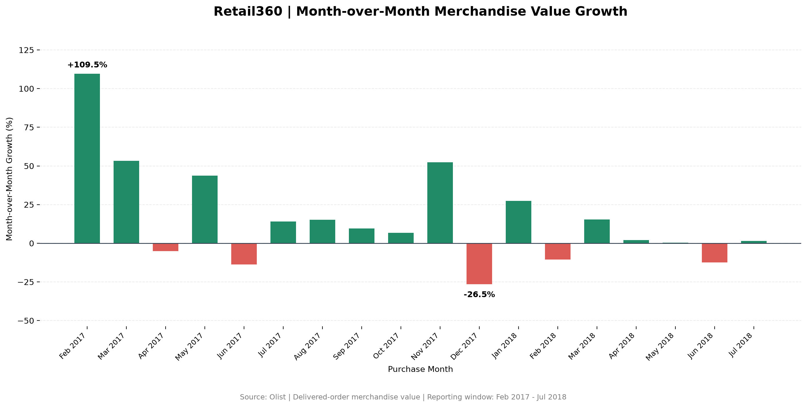
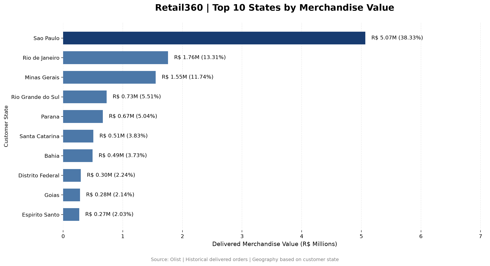
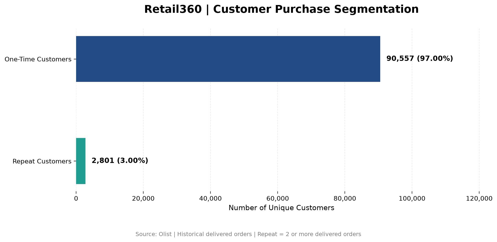
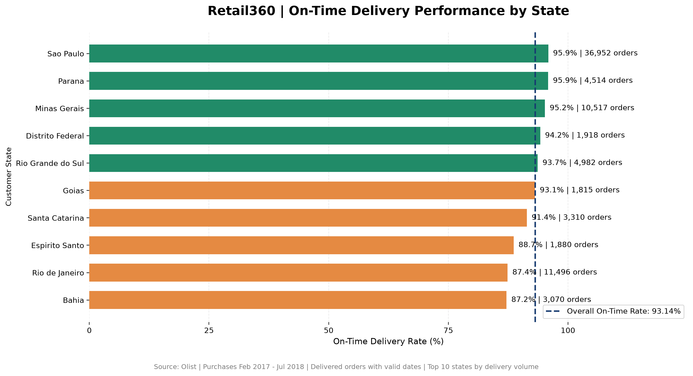

# Retail360 — E-Commerce Sales & Operations Analytics

**Python · SQL / SQLite · Power BI**  
**Data:** Brazilian E-Commerce Public Dataset by Olist (historical transactions, 2016–2018)

Retail360 investigates how product demand, regional purchasing patterns, delivery performance, and customer experience relate to e-commerce operations. The analysis combines Python-based data validation, relational SQL reporting, and an interactive Power BI executive dashboard.



## Executive overview

The dashboard supports filtering by **customer state** and **purchase month**. The figures below reflect **all states, February 2017–July 2018**.

| Metric | Result | Calculation scope |
|:--|--:|:--|
| Delivered merchandise value | **R$12.23M** | Sum of item prices for eligible delivered orders; excludes freight |
| Delivered orders | **89,110** | Distinct delivered orders with matching item records |
| Average order value | **R$137.25** | R$12,230,652.13 / 89,110 delivered orders |
| On-time delivery rate | **93.14%** | 82,986 of 89,102 delivered orders with usable delivery dates and nonnegative durations |

The merchandise value, delivered-order count, and average order value were reconciled against the SQL order-summary view. The delivery-rate denominator follows different eligibility rules and should not be equated with the order-count KPI.

## Key findings

- **Concentrated category demand:** The ten highest-value product categories contributed **62.43%** of delivered merchandise value (**R$8.25M of R$13.22M**) in the full-period category analysis. This period is broader than the executive dashboard selection.
- **Geographic concentration:** **São Paulo** accounted for approximately **R$5.07M (38.33%)** of merchandise value in the full-period state analysis, making it the largest customer-state market by value.
- **Limited repeat purchasing:** **2,801 of 93,358** distinct customers (**3.00%**) placed at least two delivered orders in the customer-frequency analysis. This is not a cohort retention rate.
- **Delivery and customer satisfaction:** Late deliveries averaged **2.23/5** in customer review scores, compared with **4.28/5** for on-time deliveries. Low ratings (1–2 stars) represented **63.65%** of late-delivery reviews versus **9.37%** for on-time reviews. These are observational associations, not causal estimates.

The supporting analyses use clearly defined, sometimes different reporting populations. Figures should only be compared directly when the filters and denominators align.

## Analytical workflow

**Nine Olist CSV tables → Python validation and transformations → SQLite tables and reporting views → Power BI model and dashboard**

1. **Data quality:** Audited row counts, nulls, duplicates, key uniqueness, and unmatched order relationships.
2. **SQL reporting layer:** Built indexed source tables, joins, CTEs, window-function analyses, and reporting views. `vw_order_summary` aggregates items and payments separately to prevent join multiplication and retains **one row per order**; `vw_item_sales` preserves item-level detail.
3. **Analysis:** Used Python and SQL to investigate product categories, monthly trends, customer frequency, geographic sales, delivery reliability, and reviews.
4. **Business intelligence:** Connected `OrderSummary` (one) to `OrderItems` (many) on `order_id` in Power BI, with KPI measures, comparative charts, and state/date slicers.


**Implementation:** [Database ingestion](scripts/21_build_sql_database.py) · [Reporting views](sql/06_reporting_views.sql) · [SQL data-quality checks](sql/05_data_quality.sql) · [Power BI dataset export](scripts/24_export_powerbi_data.py)

## Analytical visuals

| Product category performance | Delivery timing and customer reviews |
|:--:|:--:|
|  |  |

<details>
<summary><strong>Explore the remaining five analytical charts</strong></summary>

### Monthly merchandise value



### Month-over-month growth



### Geographic merchandise value



### Customer purchase frequency



### Regional delivery performance



</details>

## Data outputs

Ten aggregate reports are retained in [`reports/`](reports/), organized by analytical subject.

| Area | Reports |
|:--|:--|
| Source validation | [`dataset_audit_summary.csv`](reports/dataset_audit_summary.csv) |
| Product performance | [`all_category_performance.csv`](reports/all_category_performance.csv), [`top_10_product_categories.csv`](reports/top_10_product_categories.csv) |
| Sales and growth | [`monthly_sales_trends.csv`](reports/monthly_sales_trends.csv), [`monthly_growth_analysis.csv`](reports/monthly_growth_analysis.csv) |
| Customer experience | [`customer_repeat_summary.csv`](reports/customer_repeat_summary.csv), [`customer_satisfaction_by_delivery.csv`](reports/customer_satisfaction_by_delivery.csv) |
| Geography and delivery | [`geographic_sales_performance.csv`](reports/geographic_sales_performance.csv), [`delivery_performance_summary.csv`](reports/delivery_performance_summary.csv), [`delivery_performance_by_state.csv`](reports/delivery_performance_by_state.csv) |

## Repository structure

```text
retail360-ecommerce-analytics/
├── assets/             9 dashboard, model, and analytical PNGs
├── reports/            10 aggregated CSV reports
├── scripts/            24 Python scripts for audits, analysis, and reporting
├── sql/                6 SQL files covering analytics, validation, and views
├── requirements.txt
└── README.md
```

## Reproducing the analysis

The original row-level data and Power BI `.pbix` are not distributed in this repository. Download the **nine original CSVs** from the [Olist dataset](https://www.kaggle.com/datasets/olistbr/brazilian-ecommerce) and place them, with unchanged filenames, under `data/raw/`. Use Python 3.12 with the dependencies in `requirements.txt`.

Execute the numbered analysis scripts in [`scripts/`](scripts/) in order to regenerate the analytical reports and charts. The database and reporting layer can be rebuilt using these entry points:

```bash
python scripts/21_build_sql_database.py
python scripts/23_build_reporting_views.py
python scripts/24_export_powerbi_data.py
```

The final step writes the Power BI input tables to `data/powerbi/`. The executive dashboard and data-model screenshots document the locally developed Power BI report; its `.pbix` is withheld because the imported model contains row-level records.

**Interpretation limits:** This is historical marketplace analysis, not a live operational feed. Merchandise value is not recognized accounting revenue or profit. Some orders lack item matches or complete delivery timestamps, and category-, order-, and review-level analyses have different units of observation.

## Data source & attribution

**Olist — [Brazilian E-Commerce Public Dataset](https://www.kaggle.com/datasets/olistbr/brazilian-ecommerce)**. The source is distributed under **[CC BY-NC-SA 4.0](https://creativecommons.org/licenses/by-nc-sa/4.0/)**; attribution, non-commercial, and share-alike conditions apply to relevant derived materials.
